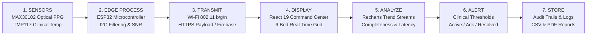

# NICU Continuous Vital Monitoring System (CradleSense)

**Modern Neonatal ICU Command Center & IoT Telemetry Platform**  
*Academic Prototype for Continuous Wireless Sensor Acquisition, Visualization, and Alerting*

---

## 🏥 Project Overview & Architecture

The **NICU Continuous Vital Monitoring System** is an IoT-based healthcare telemetry platform designed to demonstrate wireless acquisition, real-time visualization, clinical threshold evaluation, multi-bed patient tracking, staff management, and operational reporting in Neonatal Intensive Care Units.

The system follows the project report's core data workflow:
$$\text{Sense} \longrightarrow \text{Process} \longrightarrow \text{Transmit} \longrightarrow \text{Display} \longrightarrow \text{Analyze} \longrightarrow \text{Alert} \longrightarrow \text{Store}$$



---

## 🎨 Visual Identity & Clinical Ergonomics

- **Primary Background**: Soft off-white / light blue-grey (`#f8fafc` / `#f1f5f9`) for daytime clinical clarity and fatigue reduction.
- **Sidebar**: Deep navy (`#091124`) with high-visibility teal active indicator bars (`#0d9488`).
- **Primary Accent**: Crisp clinical teal (`#0d9488` / `#14b8a6`) for live streams and nominal states.
- **Signal Status Colors**:
  - **Teal / Green**: Normal / Monitoring (`#0d9488` / `#16a34a`)
  - **Amber**: Warning Conditions (`#d97706` / `#f59e0b`)
  - **Red**: Urgent / Critical Alarms (`#dc2626` / `#ef4444`)
  - **Slate Grey**: Disconnected / Stale / Data Unavailable (`#94a3b8`)
- **Theme Support**: Includes both **Light Clinical** (default) and **Dark Command Center** modes switchable with 1-click in the top header.

---

## 🧭 Five Permanent Navigation Sections

The application shell organizes the platform around five fixed navigation items, opening details, profiles, and reports as dedicated subpages:

### 1. Dashboard (`/` or `/dashboard`)
- **Top Header**: Unit branding, live digital clock (`10:36:12 AM`), real-time search box (by Baby ID `DEMO-001`, Mother's name `Ananya`, or Bed `NICU-01`), notification bell with unread count, and authenticated staff switcher.
- **Four Summary Cards**:
  1. *Total Beds*: 6 configured stations
  2. *Active Monitoring*: Beds receiving valid physiological streams
  3. *Active Alerts*: Unacknowledged or unresolved alarm events
  4. *Devices Online*: ESP32 microcontrollers communicating within heartbeat threshold
- **Six-Bed Responsive Patient Grid**:
  - Displays: Bed ID, Patient ID, Baby of [Mother's Name], Admission date, Status badge, Heart Rate (BPM), SpO₂ (%), Temperature (°C), Handling Doctor, Battery %, Signal Quality, Freshness timestamp, and Action buttons (`View patient`, `View alerts`).
  - Stale detection: Measurements older than 18s are highlighted as stale rather than presented as live.

### 1.1 Patient Details Subpage (`/patients/:patientId`)
- Full telemetry station with gestational age, birth weight, blood group, and care team.
- Large vital metric cards with target ranges and 24h extremes.
- Interactive continuous waveforms with time selector: **Last 15 Mins**, **Last 1 Hour**, **Last 24 Hours**.
- Recent alert response timeline and ESP32 hardware telemetry card (MAC, firmware, battery, RSSI).
- Reading export to CSV and printable clinical summary.

### 2. Doctors & Staff Management (`/doctors`, `/staff/:staffId`)
- Top metrics: Total staff, Doctors on duty, Nurses on duty, Unavailable staff.
- Searchable directory with multi-filters: Role (Doctor / Nurse), Shift (Morning, Evening, Night), Specialization, and Duty Availability.
- 1-click Duty Availability toggle (`On Duty`, `On Call`, `Off Duty`).
- Interactive modals:
  - **Add Doctor / Nurse**: Register new clinicians with credentials and contacts.
  - **Assign Beds & Shifts**: Assign primary lead doctors and bedside shift nurses to each of the 6 beds.
  - **Staff Profile Drawer**: Review contact info, assigned babies, and alert response history.

### 3. Alert Log (`/alerts`, `/alerts/:alertId`)
- Summary cards: Total events, Active alarms, Unacknowledged, Resolved, and Hardware faults.
- Filters: Time range, Bed selection, Severity (`Urgent`, `Warning`, `Info`), and Status (`Active`, `Acknowledged`, `Resolved`).
- Comprehensive table: Alert ID, Detection timestamp, Baby / Bed, Parameter & Value, Threshold, Assigned Clinician, Acknowledged At, Resolved At, Duration, and Status.
- **Alert Side Drawer**: Opens full context with pre/post-event vitals sequence (-30s to +30s), sensor SNR quality, notification delivery channel, and clinical resolution notes editor.

### 4. Analytics & Operational Reports (`/analytics`, `/analytics/reports`)
- **6.1 Weekly Clinical Report**: Daily alert counts bar chart by parameter, trend distributions, and latency curves.
- **6.2 Doctor & Nurse Performance**: Median time to acknowledge (benchmark < 2 mins), documented resolution rates, shift workloads, and compliance badges.
- **6.3 System Efficiency & Telemetry**:
  $$\text{Completeness} = \frac{\text{Valid readings received}}{\text{Expected readings}} \times 100\%$$
  Tracks packet reception (e.g. 98.8%), device uptime (99.8%), and upload latency (39 ms).
- **6.4 Custom Report Builder**: Select date range, target beds, and parameters to generate printable PDF reports and downloadable CSV datasets.

### 5. Settings (`/settings`)
Divided into 6 structured sub-sections:
1. **Alert Rules & Safety Limits**: Configurable thresholds for HR min/max, SpO₂ min, and Temp min/max with persistence filters, role-based guardrails, and audit logging.
2. **Device Management (ESP32)**: Registry of 6 ESP32 devices, live HTTP JSON payload viewer, Arduino C++ firmware sketch generator, and I²C sensor pinout table.
3. **NICU & Bed Configuration**: Bed identifiers, unit types (Giraffe Incubator, Radiant Warmer, Cot), and patient assignments.
4. **Users & RBAC Matrix**: Permissions table for Administrator, Doctor, and Nurse accounts.
5. **Reports & Retention**: 90-day waveform retention policies and 7-year alert audit retention compliance.
6. **Security & Audit Logs**: Cryptographic activity log tracking every threshold update, bed reassignment, and alert acknowledgment.

---

## 🛠️ Hardware Integration (ESP32 + Sensors)

### Sensor Pinout Configuration

| Component | ESP32 GPIO | Protocol | Description |
|:---|:---|:---|:---|
| **MAX30102** | GPIO 21 (SDA), GPIO 22 (SCL) | I²C (`0x57`) | Optical PPG pulse & SpO₂ estimation |
| **TMP117** | GPIO 21 (SDA), GPIO 22 (SCL) | I²C (`0x48`) | High-accuracy digital clinical skin temperature |
| **VCC** | 3.3V Pin | Power Rail | Regulated 3.3V rail |
| **Battery Divider** | GPIO 34 (ADC1) | Analog In | 100k/100k voltage divider on Li-Po battery |

### Device Ingestion Payload Sample

```json
{
  "deviceId": "ESP32-NICU-01",
  "patientId": "DEMO-001",
  "bedId": "NICU-01",
  "heartRate": 142,
  "spo2": 97,
  "temperature": 36.7,
  "batteryPercent": 84,
  "rssi": -58,
  "signalQuality": "Good",
  "sequenceNumber": 18402,
  "timestamp": "2026-10-25T10:36:12Z"
}
```

---

## 🚀 Running the Platform Locally

### Prerequisites
- Node.js (v18 or higher)
- npm

### Installation & Launch

```bash
# 1. Install dependencies
npm install

# 2. Launch Vite development server
npm run dev
```

Visit **`http://localhost:5173/`** in your browser.

### Interactive Demonstration Controls
- Click **"Simulate Alarm"** in the top header to trigger realistic Bradycardia, Tachycardia, Desaturation, or Sensor Timeout scenarios across the beds.
- Click the staff profile in the top-right to switch between **Lead Doctor (Dr. Meera)**, **Senior Nurse (Nurse Priya)**, and **Administrator (Prof. Arvind Rao)**.
- Toggle between **Light Clinical** and **Dark Command Center** themes anytime using the moon/sun toggle.

---

## 🔒 Academic Prototype Disclaimer
This software is developed as an academic engineering prototype for IoT sensor benchmarking, wireless telemetry validation, and clinical command center workflow design. It is **not** a certified medical device and must not be used to guide actual patient care.
