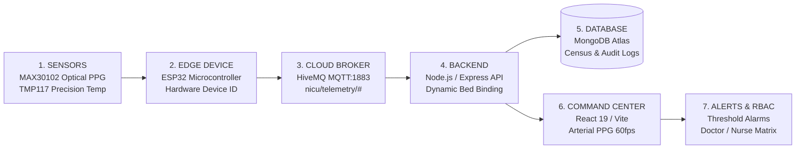

# NeoCare NICU — Continuous Vital Monitoring Command Center

**State-of-the-Art Neonatal ICU Telemetry Platform & IoT Command Center**  
*Continuous Wireless ESP32 Sensor Acquisition, Real-Time Arterial PPG Waveforms, Automated Clinical Alerting, and Role-Based Patient Management*

---

## 🏥 Project Overview & Architecture

**NeoCare NICU** is an enterprise-grade IoT neonatal telemetry command center designed to monitor neonatal bed stations in real-time. It provides continuous acquisition of physiological vitals (Heart Rate, SpO₂, and Skin Temperature) via ESP32 microcontrollers, renders real-time arterial photoplethysmogram (PPG) waveforms matching physical ICU monitors, and automates clinical threshold alarms.

### Core Telemetry Pipeline
$$\text{Sense (MAX30102 / TMP117)} \longrightarrow \text{Process (ESP32)} \longrightarrow \text{Transmit (HiveMQ MQTT)} \longrightarrow \text{Ingest (Node/Express)} \longrightarrow \text{Store (MongoDB Atlas)} \longrightarrow \text{Display (NeoCare React 19)}$$



---

## 🎨 Visual Identity & Clinical Design

- **Clinical Obsidian Dark Canvas**: Deep medical midnight (`#070b14`) engineered to eliminate clinical screen glare and fatigue.
- **Glassmorphic Clinical Surfaces**: Translucent card containers (`#0d1424` / `#131e36`) with subtle cyan/slate borders.
- **Physiological Color Palette**:
  - **Medical Cyan** (`#06b6d4`): Plethysmogram / SpO₂ waveforms and normal limits.
  - **Clinical Emerald** (`#10b981`): Active live telemetry online status ($\le 15\text{s}$ heartbeat).
  - **Warning Amber** (`#f59e0b`): Marginal temperature or tachycardia warnings.
  - **Critical Rose** (`#f43f5e`): Severe desaturations or bradycardia alarms.
  - **Slate Grey** (`#64748b`): Sanitized available bed slots or disconnected sensors.
- **60 FPS Arterial PPG Waveform**: Canvas-based photoplethysmogram (PPG) rendering the exact physiological waveform found on neonatal bedside monitors (systolic upstroke, rounded peak, dicrotic notch, and diastolic runoff).

---

## 🧭 Navigation & Clinical Modules

### 1. Dashboard (`/`)
- **NeoCare Command Center Top Bar**: Live digital clock, active alert counter, and staff role switcher.
- **Dedicated Bed Station Search**: Real-time search filter right on the dashboard to locate patients by infant name, Bed ID (`NICU-01`), patient ID, or attending neonatologist.
- **Census Summary Cards**: Total configured beds, active monitoring census, critical alerts, and online ESP32 hardware devices.
- **6-Bed Responsive Station Grid**:
  - **Admitted Patient**: Real-time arterial pulse wave, vital cards (HR, SpO₂, Temp), doctor assignment, battery backup %, and 15-second online/offline heartbeat detection.
  - **Available / Discharged Bed Slot**: Clean sanitized view indicating "Available Bed Slot (Ready for Admission)" with a direct `+ Admit Neonate` action. Discharged baby details are automatically wiped.

### 2. Patients & Inpatient Admission (`/patients`)
- **Strict Bed & Hardware Exclusivity**: When admitting a neonate, occupied beds and occupied devices are filtered out. No two patients can be assigned to the same bed or sensor node simultaneously.
- **Open Blood Group Input**: Open text field supporting custom clinical notations (`O+`, `Rh-null`, `A2B-`, etc.).
- **Discharge Protocols**: Comprehensive discharge flow recording outcome conditions, discharge weight, and directives, safely clearing the bed station back to Standby.

### 3. Patient Details Subpage (`/patients/:id`)
- **Live ICU Plethysmogram Screen**: Continuous arterial pulse wave with bedside monitor controls (`Freeze`, `Alm OFF`).
- **Telemetry Trends**: Multi-scale area charts for 15-minute, 1-hour, and 24-hour vitals.
- **Hardware Telemetry**: Device Battery Backup (runtime estimation), Wi-Fi RSSI signal quality, and MAC address.
- **Clinical PDF Export**: High-resolution printable hospital summary report styled with dedicated `@media print` rules.

### 4. Doctors & Care Team Directory (`/doctors`)
- Directory of neonatal specialists and bedside shift nurses.
- **Pediatric & Neonatal Specializations Dropdown**: Curated roles including *Consultant Neonatologist (DM Neonatology)*, *Senior Pediatric Intensivist*, *Neonatal-Perinatal Specialist*, *ECMO Fellow*, and *RN-NICU Specialist*.
- Shift rosters and 1-click duty status toggles (`On Duty`, `On Call`, `Off Duty`).

### 5. Alert Log & Audits (`/alerts`)
- Multi-parameter filter by bed, priority (`Urgent`, `Warning`, `Info`), and status (`Active`, `Acknowledged`, `Resolved`).
- Pre/post-event vital snapshots and clinical acknowledgment timestamps.

### 6. Analytics & Operational Reports (`/analytics`)
- Synchronized dynamically with live `alertLog` data.
- Weekly alarm distributions, doctor response benchmarks, and IoT packet completeness calculations.
- Printable weekly audit reports.

### 7. System Settings (`/settings`)
- **Interactive Role-Based Access Control (RBAC)**: Dropdown matrix for Doctor and Nurse roles (`Edit`, `View`, `Restricted`). Setting a module to `Restricted` completely hides it from the sidebar navigation and prevents access.
- **ESP32 Device Management & Quick Connect Guide**: Register new hardware, reassign sensor nodes across beds, run test MQTT pings, and view beginner-friendly connection instructions.

---

## 🔌 ESP32 Hardware Integration

### Decoupled Hardware Architecture
The physical ESP32 firmware does **NOT** hardcode bed IDs. The hardware transmits only its physical `DEVICE_ID` (e.g. `ESP32-NICU-01`). The NeoCare backend database dynamically maps devices to whichever bed the infant is admitted to, enabling seamless hot-swapping after discharge without reflashing.

### Arduino Sketch Setup (3-Minute Setup)
1. In Arduino IDE, install **`PubSubClient`** by Nick O'Leary (**Tools → Manage Libraries**).
2. Open [`esp32/nicu_esp32_hivemq_transmitter.ino`](file:///d:/nicu/esp32/nicu_esp32_hivemq_transmitter.ino).
3. Set your Wi-Fi name and password:
   ```cpp
   const char* WIFI_SSID     = "YOUR_WIFI_NAME";
   const char* WIFI_PASSWORD = "YOUR_WIFI_PASSWORD";
   const char* DEVICE_ID     = "ESP32-NICU-01";
   ```
4. Click **Upload**! The ESP32 connects to `broker.hivemq.com:1883` on topic `nicu/telemetry/<DEVICE_ID>`. The dashboard instantly displays green **ONLINE**.

### Multi-Bed Simulation Mode (For Single Board Testing)
If you have only 1 physical ESP32 and want to simulate telemetry across all 6 NICU stations:
```cpp
#define SIMULATE_ALL_BEDS true
```

---

## 🚀 Running Locally

### 1. Start the Backend API
```bash
cd backend
npm install
node server.js
```
*Backend runs on port 5000, connects to MongoDB Atlas, and subscribes to HiveMQ MQTT (`nicu/telemetry/#`).*

### 2. Start the Frontend Dev Server
```bash
npm install
npm run dev
```
*Frontend runs on Vite dev server at `http://localhost:5173`.*

### 3. Production Build
```bash
npm run build
```

---

## 🔒 Security & Medical Auditing
- **Permanent Dark Theme**: Default clinical viewing mode.
- **Heartbeat Freshness**: Strict 15-second timeout differentiates true live data from disconnected sensors.
- **Immutable Audit Trail**: All threshold updates, bed admissions, discharges, and alarm acknowledgments are timestamped and recorded in MongoDB.
